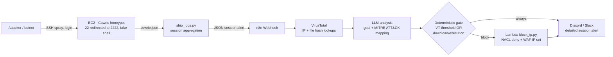

# 🍯 Intelligent Cloud Honeypot — Cowrie + VirusTotal + LLM MITRE ATT&CK + Auto-Block

An SSH honeypot that doesn't just collect attacks — it **understands and answers them**.
Cowrie on AWS EC2 captures full attacker sessions (credentials, commands, payload downloads = C2 indicators); n8n enriches every IP and file with VirusTotal, an LLM maps the session to **MITRE ATT&CK** and infers the attacker's goal, and a deterministic gate automatically **blocks confirmed attackers** (NACL deny + WAF IP set) and alerts the team on Discord/Slack.

> Portfolio project by **Gilberto A. Cedillo Soto (Abisaíd)** — Cybersecurity, BYU-Idaho (Class of 2027)
> `AWS EC2` · `Terraform` · `Cowrie` · `Python` · `n8n` · `VirusTotal API` · `LLM` · `MITRE ATT&CK` · `Threat Intelligence`

**Companion project:** [aws-n8n-soc-automation](https://github.com/gilbertocedillo/aws-n8n-soc-automation) — hardened EC2 SOC monitoring + AI auto-response.

---

## Architecture



```
[Internet bots] --22--> [iptables REDIRECT] --> [Cowrie :2222 fake shell]
                                                        | var/log/cowrie/cowrie.json
                                                        v
                                              [ship_logs.py] -- sessions: creds,
                                                commands, download URLs + SHA256
                                                        | POST JSON
                                                        v
[n8n] Webhook -> Extract -> VirusTotal (IP + file) -> Enrich -> LLM (ATT&CK JSON)
      -> Gate (code, NOT the LLM) -> IF block -> Lambda -> NACL DENY + WAF IP set
                                -> Discord/Slack detailed embed -> Respond
```

## What a captured session tells you

From [`examples/sample-cowrie-session.json`](examples/sample-cowrie-session.json): 7 login attempts (`root/root`, `admin/admin`…) → `uname -a`, `cat /proc/cpuinfo` (architecture discovery) → `wget http://…/bins/mirai.x86` (payload staging, **T1105**) → `chmod +x` + `./.x` (execution, **T1059.004**) → blocked + alerted, with the MITRE chain attached.

## Repository layout

| Path | What it is |
|---|---|
| `terraform/` | EC2 + SGs + NACL + WAF IP set + split IAM (powerless honeypot role vs. block-Lambda role) + bootstrap |
| `cowrie/` | Custom `cowrie.cfg` (plausible hostname/banner, random-auth) + Docker Compose alternative |
| `shipper/ship_logs.py` | Tails `cowrie.json`, aggregates per session, emits structured JSON to n8n (local-first, retry) |
| `n8n/workflow/honeypot-intel-response.json` | Importable workflow: VT enrichment → LLM ATT&CK analysis → gate → block → alert |
| `lambda/block_ip.py` | Idempotent blocker: **NACL deny insertion** (rule-number allocation) + WAF IP set update |
| `prompts/llm-mitre-session-analysis.md` | LLM system/user prompts + strict JSON schema for ATT&CK mapping |
| `examples/` | Realistic sample Cowrie session (Mirai-style) to test the whole pipeline without deploying |
| `docs/interview-defense-guide.md` | 30-second pitch, design decisions, likely interview Q&A |

## Key design decisions

- **Security Groups cannot deny.** SGs are allow-only/stateful, so blocking uses a **Network ACL explicit DENY** (low rule numbers evaluate first) plus a **WAF IP set** — the Lambda's docstring explains the pattern and handles idempotency + rule-number allocation.
- **The LLM describes; code decides.** Attackers control the log text (a built-in prompt-injection surface), so the block decision is a deterministic gate: VT IP malicious ≥5, VT file malicious ≥3, or real download/execution with LLM confidence ≥70.
- **Split trust:** the honeypot's IAM role can only write its own logs — if (when) it's probed, its credentials are near-worthless. Only the separate Lambda role can modify the NACL/WAF, and n8n can only invoke that Lambda.
- **Session-level intel, not log-line noise:** credentials, command sequence, and download hashes travel together as one alert.

## Setup

### 1. Deploy the honeypot (Terraform)
```bash
cd terraform
cp ../.env.example ../.env   # fill values - never commit .env
cd ../../lambda && zip block_ip.zip block_ip.py && cd ../terraform  # Lambda artifact expected by iam.tf
terraform init
terraform apply \
  -var="allowed_admin_cidr=$(curl -s ifconfig.me)/32" \
  -var="webhook_url=https://YOUR-N8N/webhook/honeypot-session"
# outputs: honeypot_public_ip, block_lambda_arn, network_acl_id, waf_ipset_id
```
Then copy `cowrie/cowrie.cfg` → `/home/cowrie/cowrie/etc/cowrie.cfg` and `shipper/ship_logs.py` → `/opt/honeypot-shipper/` on the instance (via SSM Session Manager), restart Cowrie + the shipper service. Docker alternative: `cd cowrie && docker compose up -d`.

### 2. Import the n8n workflow
Workflows → Import from File → `n8n/workflow/honeypot-intel-response.json` → set env vars (`VIRUSTOTAL_API_KEY`, `OPENAI_API_KEY`, `DISCORD_WEBHOOK_URL`, `BLOCK_LAMBDA_ARN`) → Activate.

### 3. Test without any attacker
```bash
curl -X POST https://YOUR-N8N/webhook/honeypot-session \
  -H 'Content-Type: application/json' \
  -d @examples/sample-cowrie-session.json
# Expect: n8n execution green, Discord alert with MITRE mapping,
# and (DRY_RUN=false) a new NACL deny rule for 45.155.204.139/32
```
Keep the Lambda in `DRY_RUN=true` until you've watched a few full runs.

### 4. Unblock (manual, intentional)
```bash
aws ec2 delete-network-acl-entry --network-acl-id acl-xxx --rule-number <n> --ingress
# + remove the /32 from the WAF IP set
```

## ⚠️ Safety & Ethics — read before deploying

- **Isolated by design:** dedicated instance (ideally its own VPC/subnet), **no real data, no real credentials, no routes to internal systems**. The honeypot's egress is deliberately narrow (DNS/NTP/HTTPS for updates, AWS APIs and the webhook) so a captured shell can never be used as a launchpad to attack others.
- **The only world-open ports are 22/2222, and they land on a fake shell.** Real host administration is on a non-standard port restricted to the operator's `/32`, or disabled in favor of SSM Session Manager.
- **Log-only research tool.** This project observes and blocks inbound attackers on infrastructure you own. Never use it for entrapment, never "hack back", never execute downloaded payloads (hash-lookup only), and respect your cloud provider's acceptable-use terms and local law.
- **Expect attention:** a public honeypot IP will be scanned constantly and may attract abuse complaints if misconfigured — the narrow egress and isolation above are not optional.

## Roadmap
- [ ] Auto-expiring blocks (NACL deny TTL, 7 days) + blocklist dashboard
- [ ] ASN/geo enrichment and attacker clustering across sessions
- [ ] Submit unknown download hashes to VirusTotal automatically
- [ ] Telnet listener study mode (Mirai-style IoT botnets)

## License
MIT — Copyright (c) 2026 Gilberto A. Cedillo Soto
